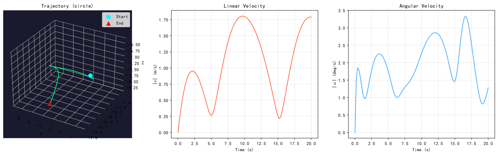

# Grey-box inverse dynamics for a salvage ROV

A dynamics model for a pool-scale work-class ROV, built as **structure plus learning**: the Fossen
6-DOF equations provide the skeleton, a network predicts the hydrodynamic parameters that are not
available analytically, and a second network absorbs what the skeleton cannot express.

The model is trained on **real tank data** (pose ground truth, IMU, DVL, pressure, thruster commands,
gripper states, contact forces) recorded from the vehicle during teleoperated runs — not on
simulation.

---

## Why grey box

Neither extreme works here.

A **white box** needs a full 6-DOF parameter set — added mass, linear and quadratic damping, restoring
terms — and those were not available for this vehicle. A **black box** (pure RNN or Transformer)
predicts plausibly for a few steps and then drifts, because it has no notion of momentum or of the
tank walls.

So the model keeps the equation structure and learns only what is missing:

```
state + control  ──►  PhysicsParamNet  ──►  hydrodynamic parameters
                                  │
                                  ▼
                        Fossen 6-DOF  (M·ν̇ + C(ν)ν + D(ν)ν + g(η) = τ)
                                  │
                                  ▼
                          RK4 integration  ──►  ν̇
                                  ▲
                                  │
                     ResidualGRU  ──►  unmodelled acceleration
```

Two design choices follow from the tank rather than from the literature:

- **The walls are analytic.** The pool has a sloped floor and a sloped water surface, so the six wall
  distances are computed in closed form (`src/pool_geometry.py`) instead of being learned. Contact is
  then a weak-supervised quantity rather than a hidden state.
- **Payload is a condition, not an input channel.** A gripper carrying an object changes the effective
  mass and damping. Payload is embedded and injected through FiLM, so the same network can represent
  several loading conditions instead of averaging over them.

## Architecture

| Module | Role |
|---|---|
| **PhysicsParamNet** | Conv1D over a 10-step history → shared MLP (256-d) → separate heads for the parameter blocks. Payload enters as an embedding through FiLM. |
| **ResidualGRU** | 2-layer GRU (128-d) → MLP → residual acceleration Δν̇ (6). This is where contact, tether and unmodelled drag land. |
| **Fossen ODE + RK4** | The predicted parameters are substituted into the rigid-body equations; a fixed-step RK4 integrator produces the state derivative. |

Inputs per step (31 dims): state (position 3, quaternion 4, linear and angular velocity 6), thruster
commands (8), environment (depth 1, altitude 1, six wall distances, contact magnitude 1), payload (1).

## Run the demo

No dataset needed. The simulator loads a checkpoint and rolls out a trajectory from an initial state
under a commanded control pattern:



*A 100-step circle pattern: 3D trajectory against the tank boundary, linear velocity, angular rate.
The flat start and the smooth decay are the integrator settling, not noise.*

```bash
pip install -r requirements.txt
python src/dynamics_simulator_v2.py --ckpt weights/ckpt_v2_best.pt \
       --pattern circle --steps 100 --output figures/demo_circle.png
```

Interactive 3D view (drag to rotate, slider to scrub time):

```bash
python src/dynamics_simulator_v2.py --ckpt weights/ckpt_v2_best.pt --interactive
```

The checkpoint is 6.3 MB and runs on CPU. Everything the demo needs is analytic: no recorded
sequences, no dataset paths.

## Honest scope

1. **The checkpoint is a working model, not a validated one.** It is an intermediate result from
   ongoing work; the numbers I would want before claiming accuracy (rollout error over 5, 20 and 100
   steps, per loading condition) are not in this repository.
2. **Training data is not included** — the recorded sequences belong to the project. The training
   script is here for reference, but it expects the original dataset layout.
3. **The demo uses approximate normalisation.** Without `--dataset-root`, the simulator falls back to
   hand-estimated mean/std for each input channel, so absolute errors from the demo are not
   meaningful; trajectories show the *shape* of the learned dynamics, not its calibrated accuracy.
   In practice this holds for roughly 100 steps; beyond that the rollout drifts and the angular rate
   turns erratic. The recorded statistics are what the trained model actually saw.
4. **The tank geometry is specific to one facility** (sloped floor, sloped surface, an extension
   region). It is kept explicit in `pool_geometry.py` precisely so it can be replaced.
5. **Payload conditioning is coarse** — a single scalar, not a mass estimate.

## Not included

- recorded sequences, training logs and intermediate checkpoints
- the world-model code this was derived from (a separate project)

## Contact

Yuncong Yang — Underwater Engineering Institute, Shanghai Jiao Tong University
[aim404@sjtu.edu.cn](mailto:aim404@sjtu.edu.cn) · [aim404.github.io](https://aim404.github.io)
